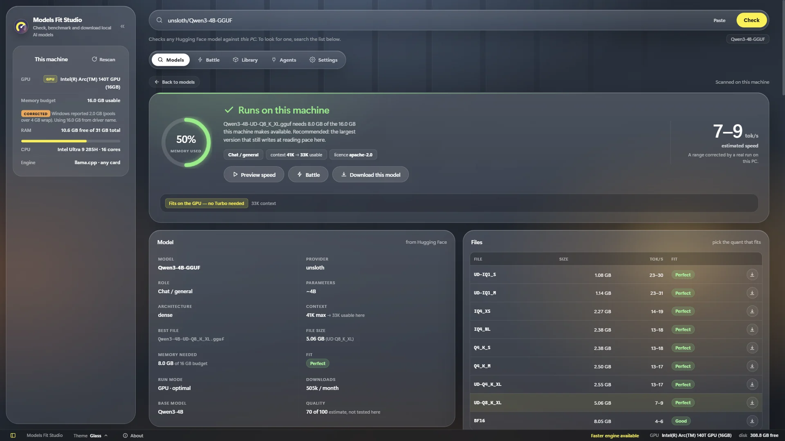
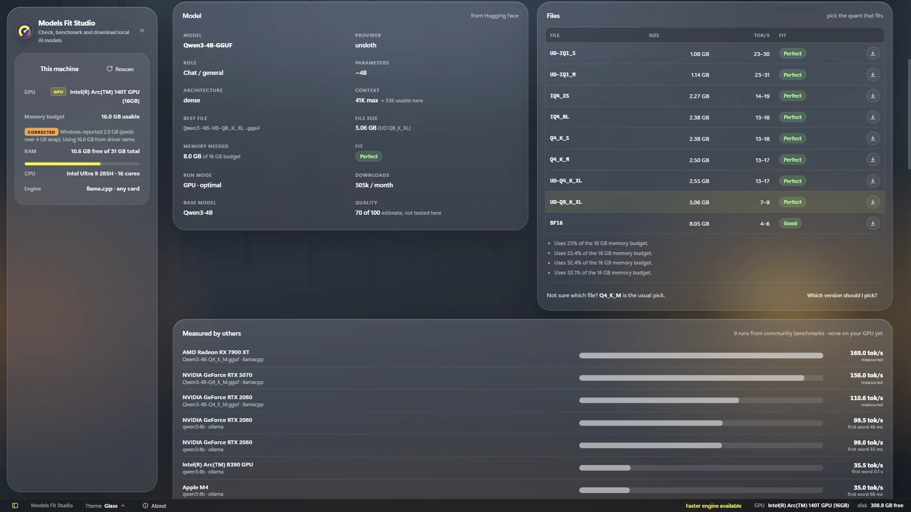
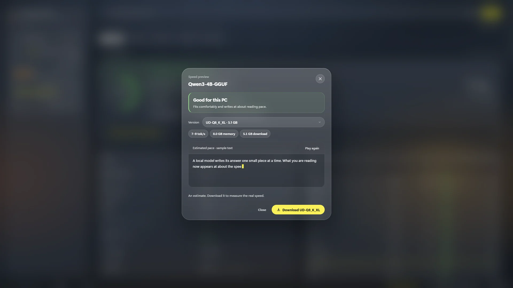
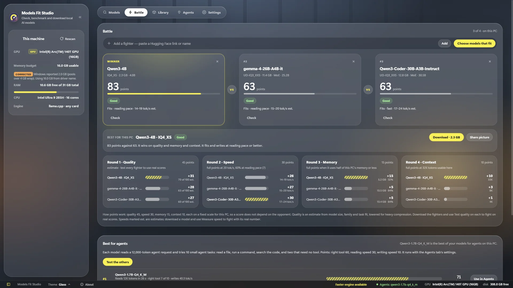
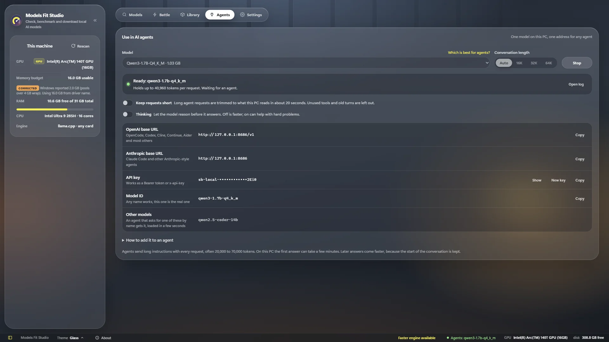
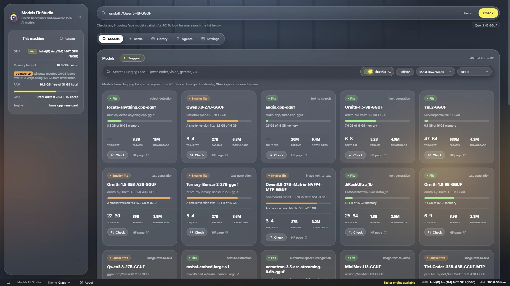
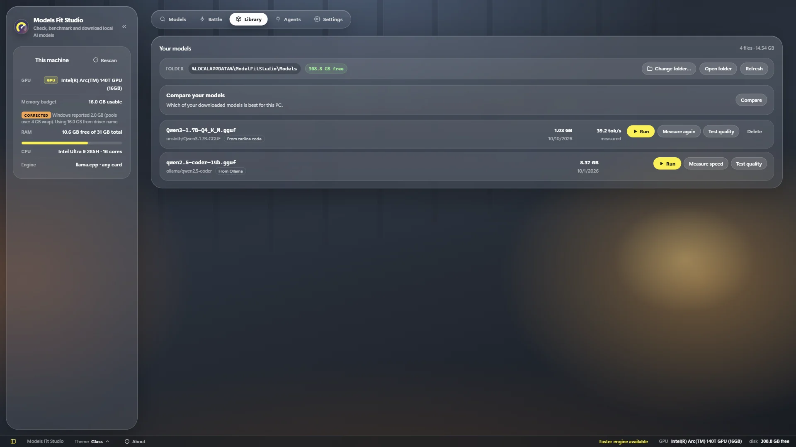
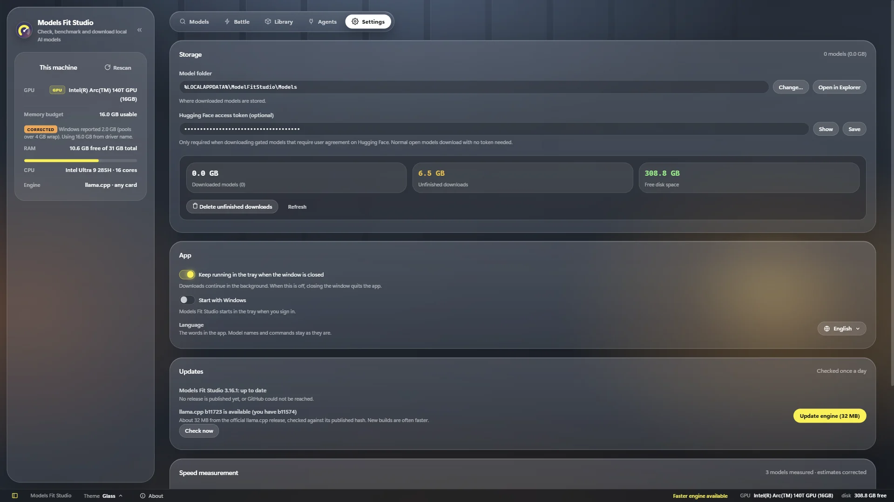
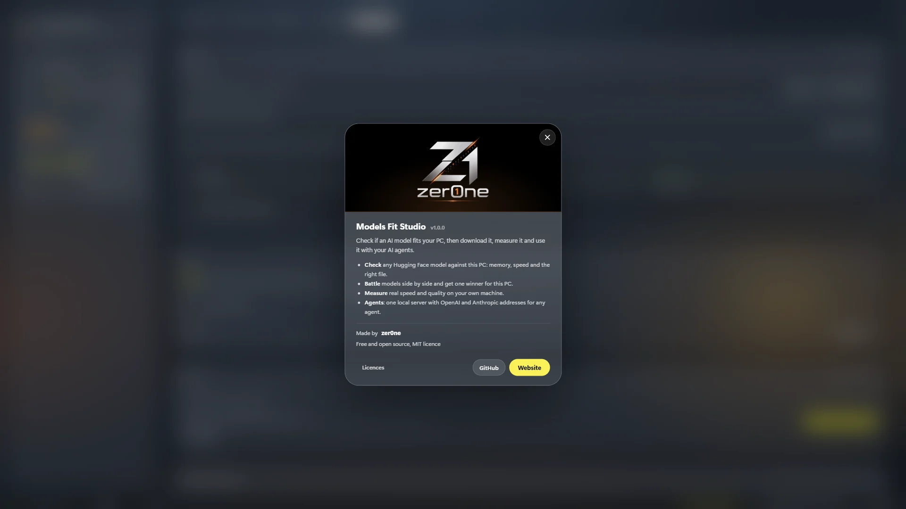

<div align="center">


# Models Fit Studio

**Check if an AI model fits your PC — then download it, measure it, and use it with your AI agents.**

A free Windows app that scans *your* hardware and tells you, in plain words, which local AI model will run well on it.

[](https://github.com/uranrog-01/models-fit-studio/releases/latest)
[](https://uranrog-01.github.io/models-fit-studio/)
[](LICENSE)
[](#install)

<a href="https://uranrog-01.github.io/models-fit-studio/#demo">
  
</a>

<sub>20-second demo · <a href="docs/assets/demo.mp4">watch the MP4</a></sub>

</div>

---

## Why use it

Most people download a 5–20 GB model, wait, and only then find out it is too big or too slow for their PC.
Models Fit Studio answers that **before** you download:

| | |
| --- | --- |
| **No guessing** | One clear verdict per model: *Runs on this machine*, *Runs, but tight*, *Runs slower* or *Won't fit*. |
| **The right file, picked for you** | A model comes as many files (Q2 … Q8, F16). The app recommends the largest one that fits and still writes at reading pace. |
| **Real numbers from your PC** | Measure the real speed and quality of a downloaded model on your own machine, in one click. |
| **Works with your AI agents** | Start one local server and paste its OpenAI or Anthropic address into Claude Code, OpenCode, Codex, Cline, Continue, Aider… |
| **Private and offline** | Models run on your computer. The engine (llama.cpp) is built in, nothing to install. |
| **Free and open source** | MIT licence. No account, no ads, no tracking. |

## How to use it — 4 steps

### 1 · Paste a model link and press **Check**

Paste any Hugging Face link or `org/model` name (for example `unsloth/Qwen3-4B-GGUF`).
The app scans your CPU, RAM and graphics chip and shows the verdict, the memory it needs, the expected speed, and which file to download.



Every version of the model is listed with its size, speed and fit, so you can see exactly where your PC's limit is.



### 2 · Preview the speed

**Preview speed** types a sample answer at the speed the model is expected to reach on your PC, so you can feel it before spending the download.



### 3 · Battle models, get one winner

Not sure which model to pick? Put up to four in a **Battle**. Each gets points out of 100 for quality, speed, memory and context, and one winner is named — with a Download button.



### 4 · Use it in any AI agent

Download the winner, open **Agents**, pick the model and press **Start**. You get an OpenAI base URL, an Anthropic base URL, an API key and the model ID — paste them into your agent.



<details>
<summary><b>Example: Claude Code</b> (PowerShell)</summary>

```powershell
$env:ANTHROPIC_BASE_URL="http://127.0.0.1:8686"
$env:ANTHROPIC_AUTH_TOKEN="sk-local-…"   # the key from the Agents tab
$env:ANTHROPIC_MODEL="qwen3-1.7b-q4_k_m"
claude
```
</details>

<details>
<summary><b>Example: OpenCode, Codex and others</b></summary>

The Agents tab has a **How to add it to an agent** section that writes the exact `opencode.json`, Codex `config.toml`, or base URL + key for any OpenAI-compatible tool, with your key and model filled in.
</details>

## More in the app

<table>
<tr>
<td width="50%"><br/><b>Models</b> — browse Hugging Face with a <i>Fits this PC</i> filter, or press <b>Suggest</b> for the best, smartest and fastest picks.</td>
<td width="50%"><br/><b>Library</b> — your downloads (and models already in LM Studio, Ollama or the Hugging Face cache) with <b>Run</b>, <b>Measure speed</b> and <b>Test quality</b>.</td>
</tr>
<tr>
<td width="50%"><br/><b>Settings</b> — model folder, Hugging Face token for gated models, updates, 11 languages and 4 themes.</td>
<td width="50%"><br/><b>About</b> — the app and its author, from the footer.</td>
</tr>
</table>

- **Measure speed** and **Test quality** (40 questions with one right answer) on your own PC — later checks are corrected by what was measured.
- **Run** a downloaded model in llama.cpp, LM Studio or Ollama, with the exact command.
- **Best for agents** — tests your models on 10 small agent tasks and names the best one for the Agents tab.
- **NVIDIA** cards get NVIDIA's own (CUDA) engine automatically; Intel and AMD use the built-in Vulkan engine.
- **Updates** for the app and the engine, checked once a day, never installed without a click.

## Install

1. Download **`Models-Fit-Studio-1.0.0-win-x64.zip`** from the [latest release](https://github.com/uranrog-01/models-fit-studio/releases/latest).
2. Unzip it anywhere (for example `C:\Apps\ModelFitStudio`).
3. Open the **Models Fit Studio** folder and run **`Models Fit Studio.exe`**.

That is all. It needs Windows 10 or 11 (64-bit) and the WebView2 runtime, which Windows already has.
Your models and settings are kept in `%LOCALAPPDATA%\ModelFitStudio`.

> Windows SmartScreen may warn on first start because the app is new and not code-signed. Choose **More info → Run anyway**.

## FAQ

**Does it need a graphics card?** No. It works on any GPU (NVIDIA, AMD, Intel Arc / Iris) and on the processor alone. It reads how much memory your graphics chip can really use.

**Does it send my data anywhere?** No. It talks to Hugging Face to list and download models, and to GitHub to check for updates. Nothing is shared unless you press **Share** yourself.

**Are the speeds exact?** Before a download they are estimates, shown as a range and corrected for your kind of GPU. After **Measure speed** they are real numbers from your PC.

**Which models work?** GGUF models from Hugging Face (the format llama.cpp runs). For a repo without GGUF files the app suggests GGUF copies.

## Build from source

Requirements: Windows, [.NET 10 SDK](https://dotnet.microsoft.com/download).

```powershell
git clone https://github.com/uranrog-01/models-fit-studio.git
cd models-fit-studio\ModelFitStudio
powershell -ExecutionPolicy Bypass -File tools\get-binaries.ps1   # llama.cpp engine + llmfit.exe from the latest release
dotnet run
```

Tests: `dotnet test CoreTests/CoreTests.csproj`. Release build, project layout and how every number is worked out: [ModelFitStudio/README.md](ModelFitStudio/README.md).

## Credits and licence


Made by **zer0ne**. Released under the [MIT licence](LICENSE).

Models Fit Studio ships two programs by other people, each under its own MIT licence:
[llama.cpp](https://github.com/ggml-org/llama.cpp) (the engine) and [llmfit](https://github.com/AlexsJones/llmfit) (the fit scorer).
Their notices are in [THIRD-PARTY-NOTICES.txt](ModelFitStudio/THIRD-PARTY-NOTICES.txt) and travel with every copy of the app.
